<p align="center">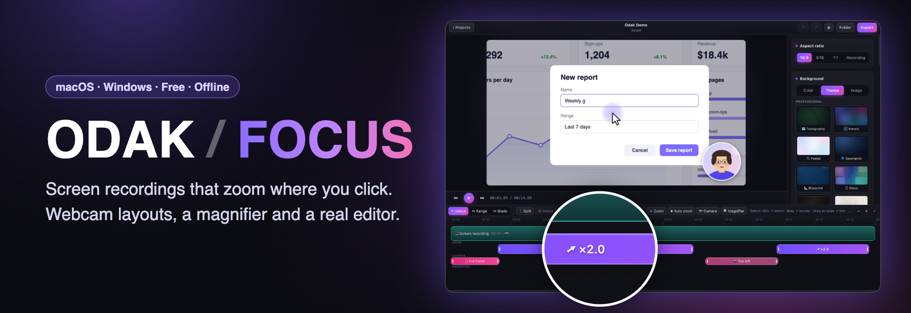</p>

# ODAK / FOCUS

**Record your screen. Odak zooms in where you click, follows your cursor, puts your webcam where your story needs it — and gives you a real editor to finish the video.**
Free, runs on **macOS and Windows**, works completely offline. *Odak* is Turkish for *focus*.

🇹🇷 [Türkçe README](README.tr.md)


<sub>Rendered by Odak itself from a demo project (the app, the presenter and the cursor path are generated for the demo). The theme changes show the same recording with different backgrounds — one click each.</sub>

### The editor in action

Every click is already a zoom. Make one deeper or point it at a fixed spot, and give the webcam its own layouts:


Add a magnifier that follows your cursor, try themes:


Cut with the scissors, play a slow part ×4, export:


<sub>Recorded from the real editor; the camera moves in on each step the same way Odak zooms in on your clicks.</sub>

---

## Contents

- [The editor in action](#the-editor-in-action)
- [Highlights](#highlights)
- [In motion](#in-motion)
- [How is Odak different?](#how-is-odak-different)
- [Screenshots](#screenshots)
- [Download and install](#download-and-install)
- [Quick start: your first video in 2 minutes](#quick-start-your-first-video-in-2-minutes)
- [User guide](#user-guide)
- [Language](#language)
- [Projects, files and privacy](#projects-files-and-privacy)
- [Performance](#performance)
- [Troubleshooting](#troubleshooting)
- [Build from source](#build-from-source)
- [How it works](#how-it-works)
- [Tests](#tests)
- [Known limitations](#known-limitations)

---

## Highlights

- 🎯 **Automatic zoom on clicks.** Odak records your cursor and clicks separately from the video. When you click, the view eases in towards that spot and follows your cursor with spring-smooth camera motion. Zooms on nearby clicks are merged; the camera settles where you spend the most time.
- ✏️ **Every zoom is editable.** Drag it, resize it, change the amount, or switch from *follow the cursor* to *a fixed point* that you pick on the frame. Regenerate the automatic ones at any time — your hand-edited zooms are kept.
- 🎥 **Webcam with timed layouts.** Record your camera together with the screen. Show it as a circle, rounded or square bubble — and for any part of the video choose a different layout: **move it to one of 9 positions, make it full frame, or hide it**. Odak animates between layouts smoothly (0.5 s eased transitions).
- 🔍 **Magnifier.** For any part of the video, a lens follows your cursor and shows what's under it larger — size (12–70 %), magnification (×1.25–×5) and shape (circle or rounded square) are adjustable; it pops open and closes smoothly.
- ✂️ **A real editor.** Split, trim, reorder, duplicate, change speed (×0.5–×8), delete a time range across clips, cut with a scissors tool, import other videos, add more recordings to the same project. Everything is undoable.
- ⏩ **Quiet moments.** One click finds the parts where nothing happens (screen unchanged, cursor still, no sound) and speeds them up or cuts them out — with a small margin so no movement gets clipped.
- 🖼️ **Looks.** 8 gradient presets, **22 themes drawn in code** — 15 professional ones for product demos, courses and business videos (Topographic, Aurora, Pastel, Geometric, Blueprint, Glass, Black & Gold, Marble, Corporate, Office lights, Finance, Graphite, Paper, Minimal dark/light) and 7 playful or seasonal ones (Fun, New Year, Autumn, Celebration, Spring, Space, Ocean) — or **your own background image** (with optional blur). Padding, rounded corners, shadow.
- 🖱️ **Cursor styles.** White, black or coloured arrow or a dot; size, highlight ring, hide when idle, motion smoothing, click effects (ring or pulse). The cursor is redrawn, so it stays sharp at any zoom.
- 🔊 **Separate audio tracks.** System audio and microphone are recorded to separate files with separate volume controls (per project and per clip). Pick any microphone and camera, with optional noise suppression.
- 📤 **Export anything.** MP4, MOV, WebM, GIF, audio-only (M4A, WAV) or a single PNG frame for your thumbnail. 720p to 4K, 24/30/60 fps, H.264 / HEVC / AV1 / VP9, three quality levels — in **16:9, 9:16 vertical (Shorts, Reels, TikTok), 1:1 square** or the recording's own shape. Export the whole video or just a selected range.
- 🎞️ **What you see is what you export.** The preview and the exporter use the same renderer and the same frame-selection rule; audio is aligned to the millisecond (verified by automated tests).
- 🌐 **English and Turkish.** The interface follows your computer's language, and you can switch it any time in **⚙ Settings** — instantly, with your project still open.

## In motion

| A webcam that follows your story | A magnifier for the details |
|---|---|
|  |  |

**One recording, every format** — the same project as 16:9, vertical 9:16 and square 1:1, playing side by side:


## How is Odak different?

Odak was inspired by apps like [Screen Studio](https://screen.studio) that made auto-zooming screen recordings popular. It is an independent project, written from scratch, and not affiliated with Screen Studio.

| | **Odak** | **Screen Studio** |
|---|---|---|
| Platforms | **macOS and Windows** (same app, same features) | macOS only |
| Price | **Free** | Paid |
| Source code | Available in this repository | Closed |

What Odak focuses on:

1. **A webcam that follows your story.** Select any time range (say 3:00–5:00) and give the camera its own layout there: another corner, the centre of an edge, full frame for an intro or a talking-head moment, or hidden while you show something under it. The camera glides to the new spot and back. Cuts inside a layout don't make it jump, and the layout stays attached to its footage when you cut or move clips.
2. **Editing in the same app.** Odak's timeline has select / range / scissors tools, range speed-up, *Quiet moments*, video import and multi-recording projects — so you can go from raw recording to finished video without another editor.
3. **Every device you use.** The same project folder opens on a Mac and on a Windows PC.
4. **Formats for every channel:** vertical 9:16 for Shorts/Reels/TikTok, square for feeds, GIF for READMEs and chats, a PNG frame for your YouTube thumbnail, M4A/WAV for podcasts.

> Feature sets of other apps change over time. This list describes what Odak does — check other apps' current versions yourself.

## Screenshots

**The editor** — preview, timeline with clips, zooms (purple: automatic, orange: edited) and camera layouts (pink), and the style panel:

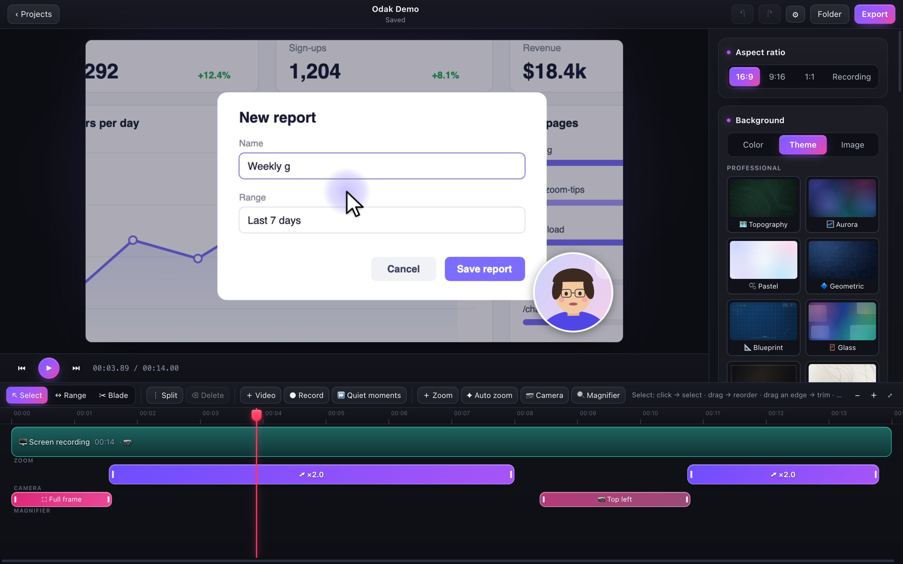

**Camera layouts over time** — here the camera moves to the top-left while the chart is shown, then comes back:

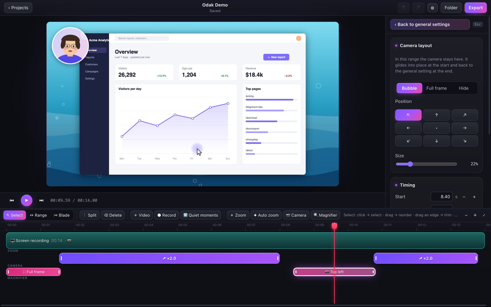

| Intro: camera full frame | A zoom on the click | Camera moved aside |
|---|---|---|
| 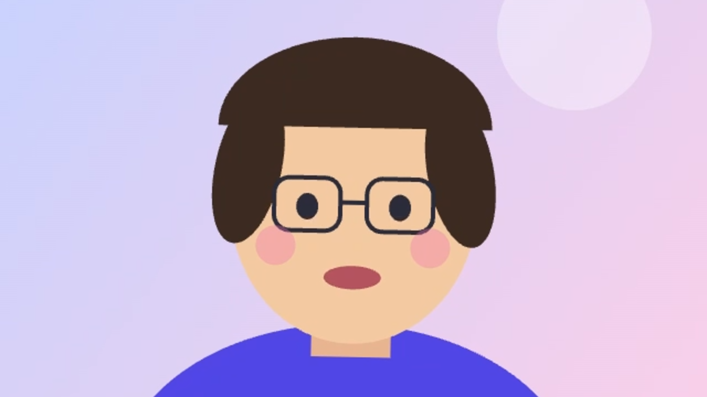 | 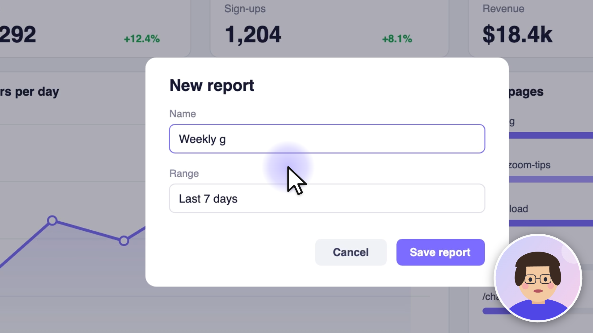 | 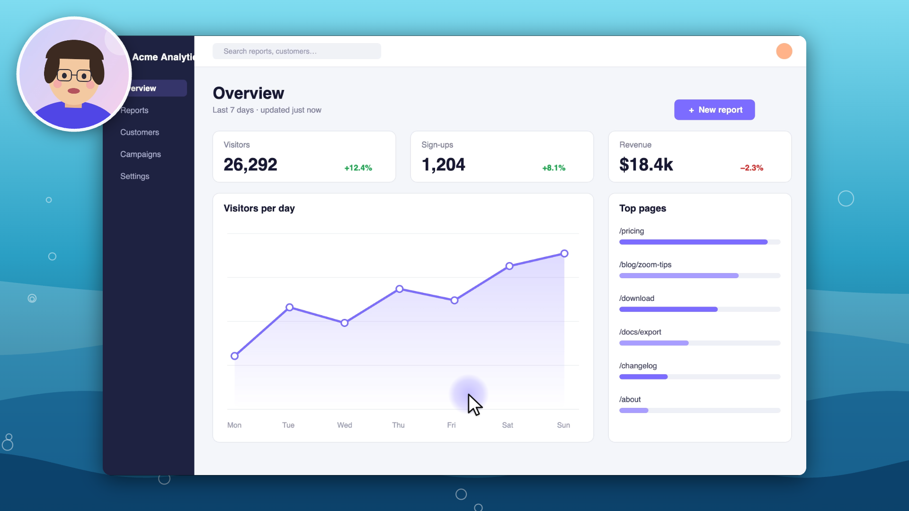 |

**Magnifier** — a lens follows the cursor for the part you choose (here on the chart tooltip):

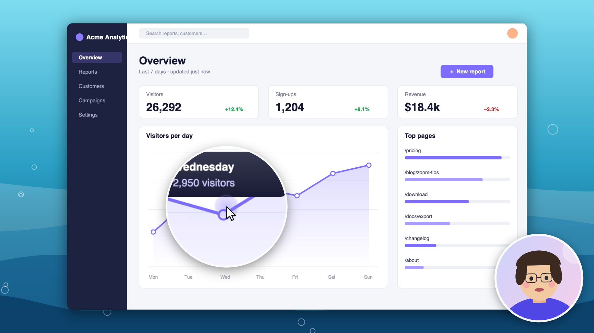

**Your own background image** (here a sunset painted in code for the demo) and **vertical 9:16** export:

| Background image | Vertical (9:16) |
|---|---|
| 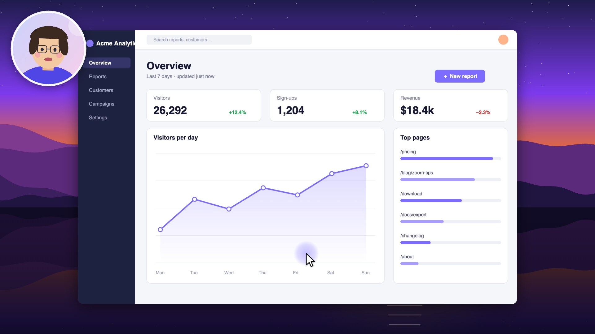 | 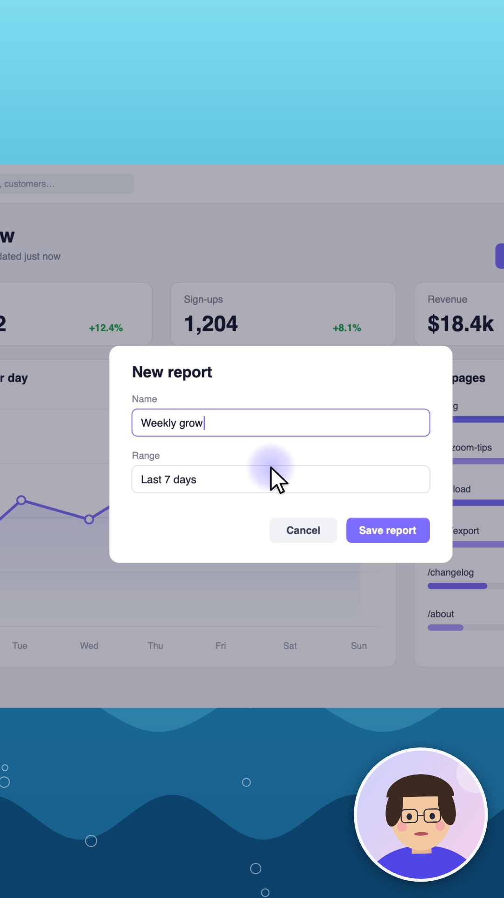 |

**Built-in themes** — all drawn in code (no downloaded artwork), sharp at any resolution and identical in preview and export.

*Professional* — for product demos, courses, sales and business videos:


The same recording on the *Corporate* theme:

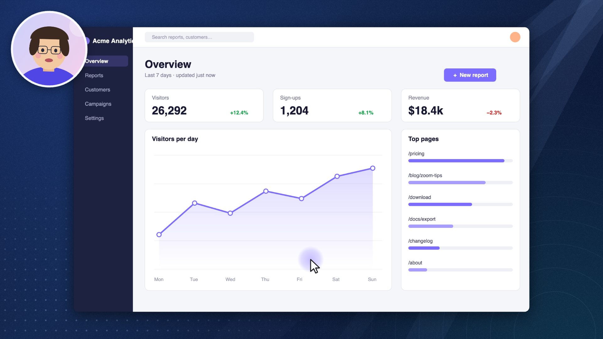

*Fun & seasonal:*

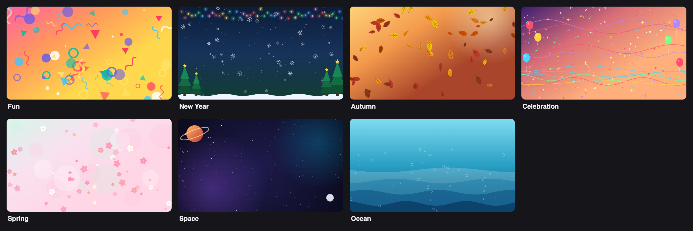

**Editing tools** — select, range and scissors; a selected range can be deleted, made its own clip, sped up ×2/×4 or given a camera layout:

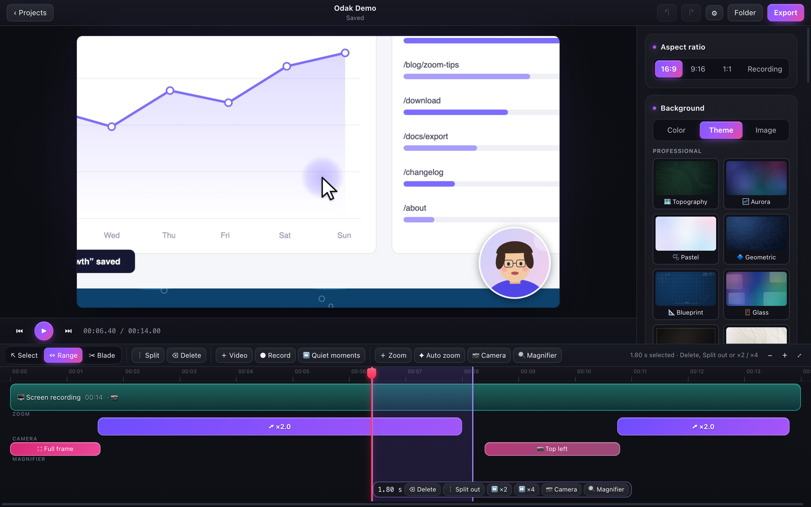

**Export** — seven formats:

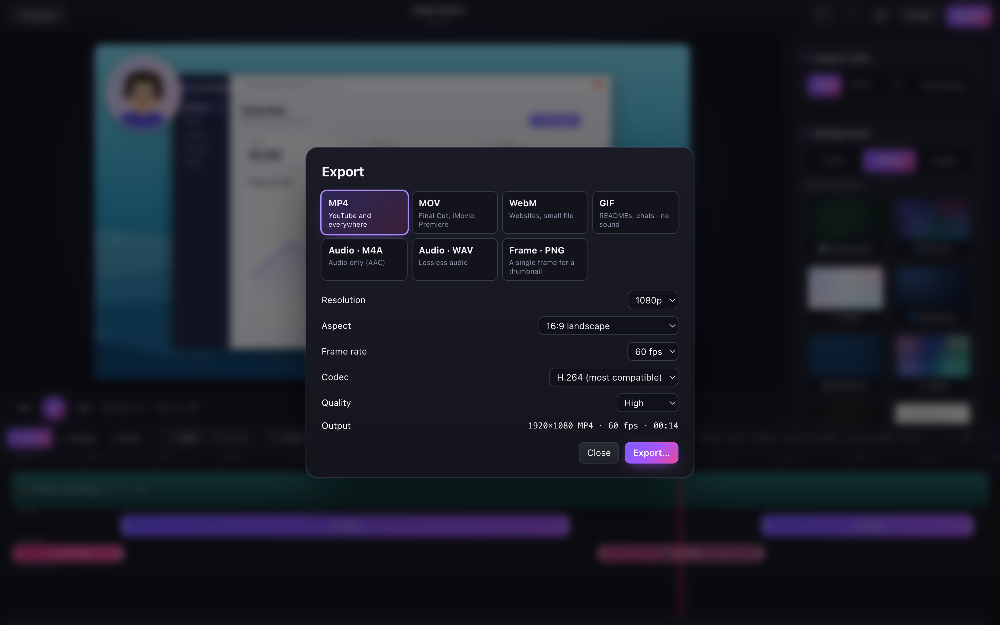

## Download and install

Go to the **[Releases page](../../releases/latest)** and download the file for your computer:

| Your computer | File | Notes |
|---|---|---|
| Mac with Apple Silicon (M1, M2, M3, M4…) | `Odak-x.y.z-mac-arm64.dmg` | macOS 14 Sonoma or newer |
| Mac with an Intel processor | `Odak-x.y.z-mac-x64.dmg` | macOS 14 or newer · passes the self-test under Rosetta, not yet tried on a real Intel Mac |
| Windows PC | `Odak-Setup-x.y.z.exe` | Windows 10 (version 2004 or newer) or Windows 11, 64-bit |
| Windows, without installing | `Odak-x.y.z-win-x64.zip` | Unzip anywhere and run `Odak.exe` |

> **Not sure which Mac you have?** Apple menu  › *About This Mac*. "Chip: Apple M…" → Apple Silicon. "Processor: Intel…" → Intel.

Odak is not signed with a paid Apple Developer ID or a Windows code-signing certificate yet, so your system will warn you the first time. This is expected; here is how to open it.

### macOS

1. Open the downloaded `.dmg` and drag **Odak** onto **Applications**.
2. Open Odak from *Applications*. macOS says it can't verify the app — click **Done** (not *Move to Trash*).
3. Open **System Settings › Privacy & Security**, scroll down to the message about Odak and click **Open Anyway**, then confirm with your password or Touch ID.
   - On macOS 14 you can instead right-click Odak in *Applications* › **Open** › **Open**.
   - Terminal alternative (removes the "downloaded from the internet" flag):
     ```bash
     xattr -dr com.apple.quarantine /Applications/Odak.app
     ```
4. On your first recording macOS asks for permissions:
   - **Screen & System Audio Recording** — required. After allowing it, macOS may ask you to quit and reopen Odak.
   - **Camera** and **Microphone** — only if you choose a camera or microphone.

   You can change these any time in *System Settings › Privacy & Security*. If recording keeps failing after an update, use the **Reset Permissions** button that Odak shows with the error, then record again and allow.

### Windows

1. Run `Odak-Setup-x.y.z.exe`.
2. If you see **"Windows protected your PC"** (SmartScreen), click **More info › Run anyway**.
3. Choose where to install and finish. Odak appears in the Start menu.
4. On first use Windows may ask for camera and microphone access (*Settings › Privacy & security › Camera / Microphone*). Screen recording needs no extra permission on Windows.

Prefer not to install? Download the `.zip`, unzip it and run `Odak.exe`.

### Updating and uninstalling

- **Update:** download the new version and install it over the old one. Your projects are separate files and are never touched.
- **Uninstall:** macOS — drag *Odak* from *Applications* to the Trash. Windows — *Settings › Apps › Odak › Uninstall*. Your recordings stay in the `Odak` folder (see [Projects, files and privacy](#projects-files-and-privacy)) until you delete them.

## Quick start: your first video in 2 minutes

1. **Open Odak.** On the home screen pick the display to record. Optionally tick *system audio* and choose a **microphone** and a **camera** (a live camera preview appears).
2. Click **● Start Recording**. Do your demo — click on the things you talk about; that's where Odak will zoom.
3. **Stop** with the small floating panel or **⌘⇧2** (macOS) / **Ctrl+Shift+2** (Windows).
4. The recording opens in the editor with automatic zooms already made. Press **Space** to watch it.
5. Pick a **Background** on the right: a colour, a theme or your own image.
6. Trim the start and end: drag the edges of the clip on the timeline.
7. Click **Export** at the top right, choose **MP4** and **1080p**, save. Done.

## User guide

> Odak's interface is in English or Turkish (see [Language](#language)); this guide uses the English labels.

### Recording

- **What is recorded:** the screen *without* the system cursor (the cursor is drawn back later, so it can be smoothed, resized and highlighted), the cursor path and clicks, system audio, your microphone and your camera — each to its own file, all on one clock.
- **Choose devices** on the home screen: display, system audio on/off, microphone (any input, e.g. a USB mic), camera, and noise suppression for the mic.
- **Stop:** the floating panel or **⌘⇧2 / Ctrl+Shift+2**. The floating panel is hidden from the recording itself.
- **Add another recording to an open project:** **● Record** in the editor's toolbar. It is added to the end of the timeline with its own automatic zooms.

### Zooms

- Automatic zooms are created from your clicks: the view eases in a little before the click, holds while you work there and eases out after a pause. Clicks close to each other share one zoom.
- **Move** a zoom by dragging it; **change its length** by dragging its edges. Click it to open its settings on the right:
  - **Amount**: ×1.1 to ×4, with one-click presets ×1.25 / ×1.5 / ×2 / ×2.5 / ×3.
  - **Follow cursor** or **Fixed point** — click or drag on the small picture to choose the point.
  - **Transition**: how gently every zoom eases in and out.
  - **‹ Previous / Next ›**: jump between zooms without hunting on the timeline.
  - Every panel ends with a **Shortcuts** card listing the keys for what you're editing.
- **＋ Zoom** (or `Z`) adds a zoom at the playhead. **✦ Auto zoom** regenerates the automatic zooms; zooms you edited by hand are kept.
- **Zoom transition** in the general settings: gentle, normal or quick camera motion.

### The timeline and editing tools

The bar above the timeline has three tools (the right side of the bar always explains the current one):

| Tool | Key | What it does |
|---|---|---|
| **↖ Select** | `V` | Click a clip to select it, drag to reorder, drag its edges to trim. **Shift+drag** selects a time range. |
| **↔ Range** | `R` | Drag across the clips to select any part of the video. Drag the range's ends to adjust it. |
| **✂ Blade** (scissors) | `C` | Click on a clip to cut it exactly there. A dashed line shows the cut; it snaps to the playhead. |

Moving around:
- Drag the **red playhead** by its head (or anywhere on the ruler). While you drag, Odak shows the nearest key frame instantly; the exact frame appears as soon as you stop.
- **Space** play/pause · **←/→** one frame (**Shift** = 10 frames) · zoom the timeline with **− / ＋ / ⤢** or **Ctrl/⌘ + mouse wheel**.

Editing:

| Action | How |
|---|---|
| **Split** | Put the playhead there and press **┆ Split** or `S` (with a range selected, it splits at both ends). Zooms are split too. |
| **Trim** | Drag a clip's left/right edge. Trimmed parts are not deleted — drag the edge back to restore them. |
| **Reorder** | Drag a clip; a yellow line shows where it will land. |
| **Delete** | Select a clip, zoom, camera layout or range and press **⌫ Delete** or the `Delete` key. Later clips move up; no gaps. |
| **Part of the video** | Select a range, then use the bar under it: **Delete**, **Split out** (make it its own clip), **×2 / ×4** (speed up), **📷 Camera** (camera layout), **🔍 Magnifier**. Works across several clips at once. |
| **Duplicate, speed, volume** | Select a clip; the right panel has **Duplicate**, speed ×0.5–×8, source start/end and per-clip volumes. |
| **Import a video** | **＋ Video** — MP4, MOV, M4V, WebM or MKV. It is copied into the project and inserted after the selected clip. |
| **Quiet moments** | **⏩ Quiet moments** — set the minimum length, choose *speed up ×2/×4/×8* or *cut*, and see the new duration before applying. |
| **Undo / redo** | **⌘Z / ⇧⌘Z** (macOS), **Ctrl+Z / Ctrl+Shift+Z** (Windows). Every edit is undoable. |

To get back to the general style settings from a clip, zoom or camera layout panel, click **‹ Back to general settings** at the top of the panel or press **Esc**.

### Camera

General settings (right panel, **Camera** section): show/hide, **9 positions** (corners, edge centres, centre), size, shape (circle, rounded, square), mirror, white border.

**Camera layouts for a part of the video:**
1. Select the part with **↔ Range** (or put the playhead where it should start).
2. Click **📷 Camera** or press `K` (in the bar under the range, or in the toolbar — then it covers the next 3 seconds).
3. A pink block appears in the **CAMERA** lane and its settings open on the right:
   - **Bubble**: one of 9 positions and its own size.
   - **Full frame**: the camera fills the whole video — great for intros and outros.
   - **Hide**: the camera fades away and comes back afterwards.
4. Drag the block to move it, drag its edges to change its length.

The camera eases into the new layout at the start of the block and back at its end (0.5 s). Two blocks next to each other hand over directly, without visiting the default position in between.

### Magnifier

1. Select the part with **↔ Range** (or put the playhead where it should start).
2. Click **🔍 Magnifier** or press `B` (in the bar under the range, or in the toolbar — then it covers the next 3 seconds).
3. A yellow block appears in the **MAGNIFIER** lane and its settings open on the right:
   - **Size**: the lens diameter, 12–70 % of the frame's short side (presets *Small / Medium / Large*).
   - **Magnification**: ×1.25 to ×5 (presets ×1.5 / ×2 / ×3).
   - **Circle / Rounded square**.
4. Drag the block to move it, drag its edges to change its length.

The lens follows the (smoothed) cursor, pops open at the start of the block and closes at its end. It works together with zooms and camera layouts, and a cut inside a lens block doesn't make it close and reopen.

### Looks

- **Aspect ratio**: 16:9, **9:16 vertical**, 1:1 square or the recording's own. The preview changes immediately; the camera bubble keeps a consistent size in every shape.
- **Background**: **Color** (gradient presets or your own two colours), **Theme** (22 themes drawn in code, in two groups: *Professional* and *Fun & seasonal*) or **Image** (your own image — PNG, JPG or WEBP, copied into the project — with optional blur).
- Padding, rounded corners and shadow.
- **Cursor**: style (white / black / coloured arrow, dot), colour, size, highlight ring, hide when idle, smoothing, click effect (ring or pulse).
- **Audio**: separate volume for system audio and microphone.

### Export

Click **Export** at the top right or press **⌘E / Ctrl+E**.

| Format | Best for | Options |
|---|---|---|
| **MP4** | YouTube, everywhere | H.264 (most compatible), HEVC (smaller), AV1 (smallest, slow) |
| **MOV** | Final Cut, iMovie, Premiere | H.264, HEVC |
| **WebM** | Websites | VP9, AV1 · Opus audio |
| **GIF** | READMEs, chats (silent) | 480–1280 px wide, 10–25 fps; identical frames are merged, so still moments cost almost nothing |
| **Audio · M4A** | Podcasts, captions | AAC audio only |
| **Audio · WAV** | Audio editing | Lossless PCM |
| **Frame · PNG** | YouTube thumbnail | The frame under the playhead, at the chosen resolution |

- Video options: resolution 720p / 1080p / 1440p / 4K, 24 / 30 / 60 fps, quality *High* / *Medium* / *Small file*. Codecs your computer can't encode are greyed out.
- **Only the selected range**: if a range is selected on the timeline, export just that part — handy for GIFs.
- A progress bar shows the time left; you can cancel. When it's done, **Show in Folder** or **Open**.

### Keyboard shortcuts

| Key | Action |
|---|---|
| `Space` | Play / pause |
| `←` / `→` | Previous / next frame (`Shift`: 10 frames) |
| `V` / `R` / `C` | Select / Range / Blade tool |
| `S` | Split at the playhead (or at both ends of the selected range) |
| `Z` | Add a zoom at the playhead |
| `K` | Add a camera layout at the playhead (or for the selected range) |
| `B` | Add a cursor magnifier at the playhead (or for the selected range) |
| `Delete` / `Backspace` | Delete the selected clip, zoom, camera layout, magnifier or range |
| `Esc` | Clear the selection, back to the Select tool and the general settings |
| `⌘Z` / `Ctrl+Z` | Undo |
| `⇧⌘Z` / `Ctrl+Shift+Z` | Redo |
| `⌘E` / `Ctrl+E` | Export |
| `⌘⇧2` / `Ctrl+Shift+2` | Stop recording |
| `⌘` / `Ctrl` + mouse wheel | Zoom the timeline |
| `⌘,` / `Ctrl+,` | Settings (language) |

## Language

Odak speaks **English** and **Turkish**.

- **Automatic:** Odak uses your computer's language — Turkish when your system's first language is Turkish, English for every other language.
- **Change it any time:** click **⚙ Settings** (top right of the home screen, or the ⚙ button in the editor's toolbar; also *Odak › Settings…* on macOS, *File › Settings…* on Windows, or `⌘,` / `Ctrl+,`) and pick **System language**, **Türkçe** or **English**. The whole interface switches immediately; an open project stays open and nothing is lost.
- The menu bar has a **Dil · Language** submenu too, labelled in both languages so it's easy to find whichever language is on.
- Your choice is remembered. Projects don't depend on the language: a project made in Turkish opens in English and vice versa.

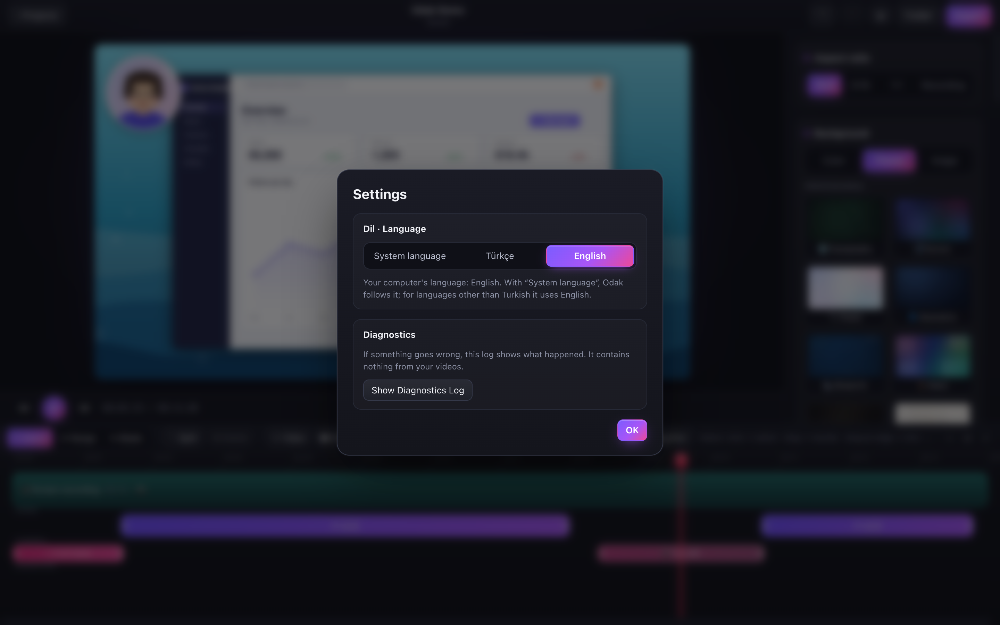

## Projects, files and privacy

- **Everything stays on your computer.** Odak has no account, no cloud, no analytics and makes no network requests.
- Recordings are saved as project folders in **Movies/Odak** (macOS) or **Videos\Odak** (Windows). Edits are saved automatically; close the app and continue later.
- A project is a plain folder you can back up, copy to another computer (Mac ↔ Windows) or inspect:

```
Recording 2026-10-15 10.12.30.odak/
  project.json                 your edits: clips, zooms, camera layouts, look, export settings
  media/<id>/screen.mp4        the raw screen video (without the system cursor)
  media/<id>/cursor.json       cursor samples and clicks
  media/<id>/system.wav        system audio (separate track)
  media/<id>/mic.wav           microphone (separate track)
  media/<id>/camera.mp4        webcam (on the same timeline as the screen)
  assets/                      background images you chose (copied in)
```

- Raw recordings are never modified — every edit is just data in `project.json`.
- A diagnostics log (no screen content) helps with bug reports: *Help › Show Diagnostics Log* (also in **⚙ Settings**), or `~/Library/Logs/Odak/odak.log` on macOS and `%APPDATA%\Odak\logs\odak.log` on Windows.

## Performance

Odak ships with a performance test (`npm run perftest`) that builds a deliberately heavy project — 40 s of 2560×1600 60 fps screen video with busy content, a 1280×720 camera, two audio tracks, 16 clips with cuts and speed changes, zooms and camera layouts — and drives the real editor in a visible window.

Results on an Apple M4 Pro with a 120 Hz display (packaged app):

| Measurement | Result |
|---|---|
| Open project → first frame | ~0.1–0.2 s |
| Playback | display refresh rate (120 frames/s), no late frames, longest gap ~10 ms **including cuts** |
| Dragging the playhead | ~59 frames/s shown, exact frame ~40 ms after letting go |
| Editing (split, select, undo…) | ~17 ms from action to screen |
| Timeline zoom and scroll | no dropped frames |
| Export 1080p60 | ~3× faster than real time; the interface stays smooth |
| Choosing a theme | drawn once at 1080p in ~3–60 ms, then reused for every frame |

How: the decoders for the next clip are opened before playback reaches a cut; while the editor is idle, every kind of frame the project will show is drawn once off screen, so the GPU never stops mid-playback to prepare a new kind of drawing (the cursor and the theme thumbnails are drawn on the CPU, and only the time and the play button are redrawn while playing, so this holds even on a first launch, before the GPU has cached anything); scrubbing shows the nearest key frame first; macOS recordings get a key frame at least every second (even when the screen is still).

Windows performance has not been measured on real hardware yet; the CI workflow runs the same test on Windows (report only, CI machines have no GPU).

## Troubleshooting

**Recording fails although Odak has permission (macOS).** After an update, macOS sometimes keeps a stale permission. Click **Reset Permissions** in the error message, start recording again and allow access. You may need to quit and reopen Odak.

**"Odak can't be opened" / "damaged" (macOS).** See [macOS install](#macos): *System Settings › Privacy & Security › Open Anyway*, or run the `xattr` command shown there.

**"Windows protected your PC".** Click **More info › Run anyway**. This appears because the installer isn't code-signed yet.

**My camera or microphone isn't listed.** Close other apps using it, then reopen Odak. On macOS check *System Settings › Privacy & Security › Camera / Microphone*; on Windows *Settings › Privacy & security*.

**A recording made on a very large Windows display won't play.** Displays larger than 4096×2304 are recorded with HEVC on Windows; editing them requires a computer that can decode HEVC (on Windows: the *HEVC Video Extensions* from the Microsoft Store).

**The GIF is huge.** GIFs are uncompressed by nature. Select a range on the timeline and tick *Only the selected range*, use 480–800 px and 10–15 fps.

**Something else.** Open an issue and attach the diagnostics log (*Help › Show Diagnostics Log*).

## Build from source

Requirements:
- **Node.js 22**
- **macOS:** Xcode or the Command Line Tools (`xcode-select --install`)
- **Windows:** [Rust](https://rustup.rs) and *Visual Studio Build Tools* ("Desktop development with C++")

```bash
git clone https://github.com/YildizDikme/Focus.git
cd Focus
npm install
npm run build:helper:mac      # macOS: Swift capture helper (universal: Apple Silicon + Intel)
npm run build:helper:win      # Windows: Rust capture helper
npm run dev                   # development mode
npm run dist:mac              # macOS: .dmg / .zip for arm64 and x64 → release/
npm run dist:win              # Windows: Setup .exe / .zip → release/
```

In development mode (`npm run dev`) macOS asks for permissions for "Electron"; the packaged app asks for "Odak".

**Publishing a release:** push a version tag — CI builds and tests on macOS and Windows and attaches the installers to a GitHub Release:

```bash
git tag v0.1.0
git push origin v0.1.0
```

## How it works

```
┌──────────────── Electron (same code on macOS and Windows) ───────────────┐
│  UI: React + TypeScript                                                  │
│  core/    project model · auto zoom · cursor clustering · spring camera  │
│           · camera layouts · editing operations (pure, unit-tested)      │
│  render/  one Canvas 2D renderer ──┬── preview player (Web Audio clock)  │
│                                    └── exporter (mediabunny + WebCodecs) │
│  media/   camera + microphone recorder (WebCodecs), media library        │
│  electron/main  files · project folders · menus · recording control      │
└────────────────┬─────────────────────────────────────────────────────────┘
                 │ JSON lines over stdin/stdout (same protocol)
     ┌───────────┴──────────┐                ┌──────────────────────────────┐
     │ macOS: Swift          │                │ Windows: Rust                │
     │ ScreenCaptureKit      │                │ Windows Graphics Capture     │
     │ cursor hidden, H.264  │                │ cursor hidden, H.264 (MF)    │
     │ host clock            │                │ QPC clock                    │
     │ system audio          │                │ WASAPI loopback (system audio)│
     └───────────────────────┘                └──────────────────────────────┘
```

- **Why native capture helpers?** Chromium's screen capture can't reliably hide the system cursor, and the cursor has to be hidden to redraw, smooth and resize it.
- **Sync:** screen frames, cursor samples and system audio share one clock (host time on macOS, QPC on Windows). The helper reports the time of the first screen frame; camera and microphone come from one MediaStream (lip-sync preserved) and are aligned to it. Audio is written as 16-bit WAV aligned to the first screen frame (gaps filled with silence, overlaps dropped).
- **Preview = export:** both call the same `drawFrame` and pick frames with the same rule (the last frame starting at or before the time). The exporter measures and compensates the audio encoder's priming delay per codec and container.
- **Playback:** the Web Audio clock is the master clock; video frames are decoded sequentially and drawn for the time it reports. Decoders for the next clip are opened ahead of a cut, sooner when its first frame is far from a key frame.

## Tests

```bash
npm test               # core: zoom/camera algorithm vs reference values; split/trim/reorder/speed/range/quiet moments;
                       #   camera layouts (transitions, cuts, hand-over, overlaps); translations (every text has
                       #   English with the same placeholders, nothing Turkish left outside the translation calls)
npm run selftest       # in the app: synthetic recording → zoom → save/open → export → preview = export (PSNR),
                       #   audio sync to the millisecond, camera bubble, themes, cursor styles, recording with fake devices,
                       #   an edited multi-clip export, camera layouts, and every export format (MP4/MOV/WebM/
                       #   vertical/square/HEVC/M4A/WAV/GIF/PNG: size, length, audio position)
npm run uitest -- "examples/Örnek Proje.odak"   # the real UI driven by DOM events: zooms, split/trim/drag/delete,
                                               #   playhead dragging, scissors, ranges, camera layouts, import,
                                               #   quiet moments, export dialog, undo, autosave, Z/K/B keys,
                                               #   no clipped labels in the side panels, real mouse input,
                                               #   Settings: switching language in place, no Turkish left in English
                                               #   (add `--lang en` to run every flow in English; CI runs both)
npm run perftest       # performance (see above)
npm run docshots       # regenerates docs/images from a demo project: the banner, screenshots, frames, theme
                       #   galleries, the demo GIF, the feature GIFs and the editor GIFs (English interface)
npm run docshots:tr    # the banner and editor screenshots with the Turkish interface → docs/images/tr (README.tr.md)
zsh native/mac/test.sh # macOS helper: WAV alignment, key frames at most ~1 s apart
cargo test --manifest-path native/win/Cargo.toml   # Windows helper: WAV alignment
node scripts/helper-smoke.mjs                      # records 3 s of this screen with the helper (needs permission)
```

`.github/workflows/build.yml` runs all of this on **Windows and macOS** for every push and builds the installers.

## Known limitations

- The apps are not signed/notarized with Apple/Microsoft certificates yet, so the first launch shows a warning (see [Download and install](#download-and-install)).
- Intel Mac builds pass the in-app self-test under Rosetta but haven't been tried on a real Intel Mac yet.
- Displays larger than 4096×2304: on macOS the recording is scaled to fit; on Windows HEVC is used, which needs HEVC decoding to edit.
- Linux: editing and export work when built from source; recording is not supported yet.
- Clips that play faster or slower than 1× are silent (no pitch-preserving time-stretch yet).
- *Quiet moments* works on Odak's own screen recordings (it uses the cursor data); imported videos aren't analysed.
- On Windows the capture library doesn't let Odak choose the key-frame interval; the player compensates by preparing the next clip earlier.
