<p align="center">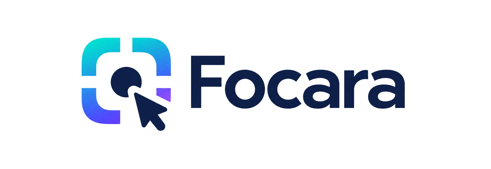</p>

# Focara

🇬🇧 [English README](README.md) · Focara'nın önceki adı Focus, daha önceki adı Odak'tı.

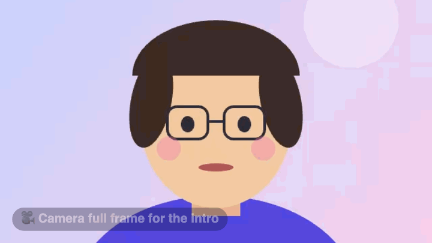

**Editör çalışırken:** Her tıklama zaten bir zoom. Birini derinleştir ya da sabit bir noktaya çevir, kameraya kendi düzenlerini ver:

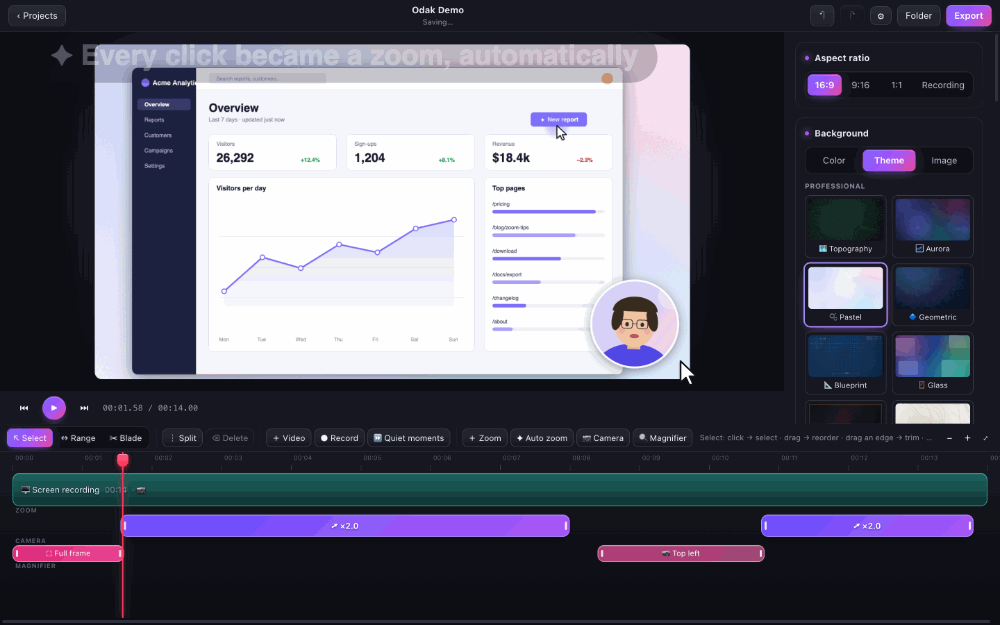

İmleci takip eden bir büyüteç ekle, temaları dene:

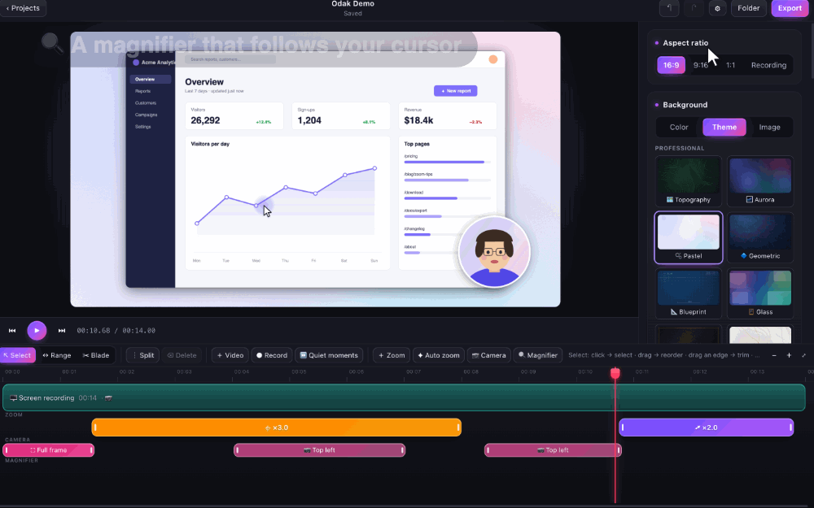

Makasla kes, yavaş bir kısmı ×4 hızlandır, dışa aktar:

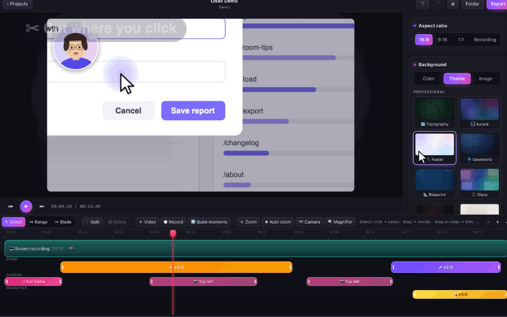

| Hikâyeni takip eden kamera | Ayrıntılar için büyüteç |
|---|---|
| 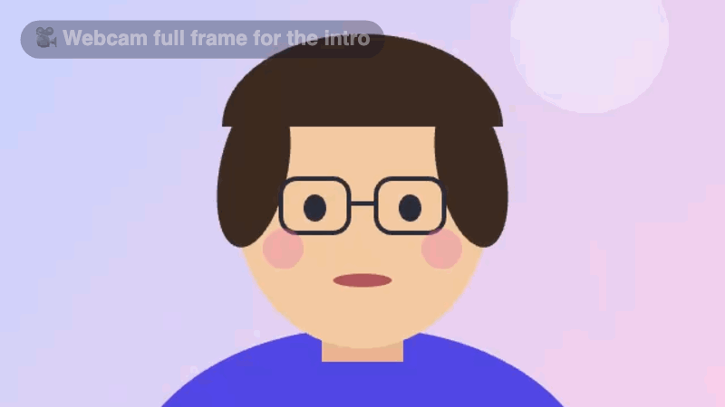 | 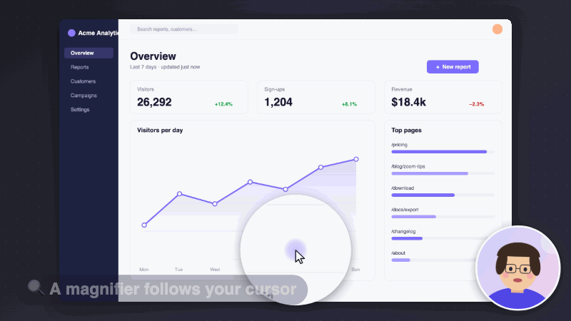 |

**Tek kayıt, her biçim:** aynı proje 16:9, dikey 9:16 ve kare 1:1 olarak yan yana:

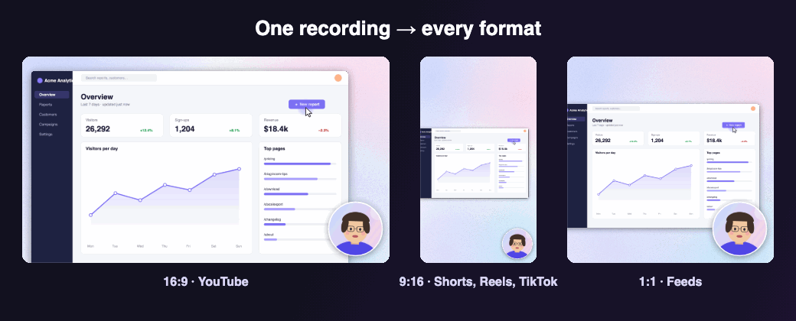

Ekran kaydı, otomatik zoom ve zoom'ları elle düzenleme. **macOS ve Windows'ta aynı şekilde çalışır.**

- Kayıtta sistem imleci gizlenir. İmleç konumu ve tıklamalar ayrıca saklanır; imleç sonradan yeniden çizilir, yumuşatılır ve boyutlandırılır.
- Zoom'lar tıklamalardan otomatik oluşur. Her zoom'un zamanı, miktarı ve odağı (imleci takip / sabit nokta) düzenlenebilir.
- **Düzenleme:** Birden çok kayıt ve bilgisayardan video tek zaman çizelgesinde. Böl, kenarından kırp, sürükleyip sırala, çoğalt, aralık seçip sil, klip hızı (×0.5–×8). **Durgun anlar** tek adımda bulunur, hızlandırılır ya da kesilir.
- **Dışa aktarma:** MP4, MOV, WebM, GIF, yalnızca ses (M4A, WAV) ya da tek kare (PNG). 720p–4K, 24/30/60 fps, H.264 / HEVC / AV1 / VP9, üç kalite düzeyi. Görüntü oranı 16:9, **9:16 dikey** (Shorts, Reels, TikTok), 1:1 kare ya da kaydın kendi oranı. İstersen yalnızca seçili aralık aktarılır.
- **Büyüteç:** Videonun istediğin kısmında imleci takip eden bir büyüteç açılır ve altını büyütür. Boyutu (%12–70), büyütmesi (×1.25–×5) ve şekli (daire / yuvarlak kare) ayarlanır; yumuşak bir animasyonla açılıp kapanır. Aralığı seç, **🔍 Büyüteç**; bölüm BÜYÜTEÇ şeridinde görünür.
- Önizleme ile dışa aktarılan dosya aynı çizim koduyla üretilir. Görüntü, zamanlama ve ses senkronu aynıdır.
- **Kamera:** Ekranla aynı anda kaydedilir. Videoda daire, yuvarlak köşe ya da kare balon olarak görünür; 9 konumdan birine yerleşir, boyutu, ayna görüntüsü ve çerçevesi ayarlanabilir. **Kamera bölümleri** ile videonun istediğin kısmında kamera başka yere kayar, tam ekran olur ya da gizlenir.
- **Ses:** Sistem sesi ve mikrofon ayrı dosyalara kaydedilir, ses düzeyleri ayrı ayarlanır. Kamera ve mikrofon listeden seçilir (örneğin harici USB mikrofon), gürültü azaltma isteğe bağlıdır.
- **Arka plan:** Hazır renk geçişleri, temalar ya da bilgisayarından seçtiğin bir görsel (bulanıklaştırılabilir). 22 tema, iki grupta:
  - **Profesyonel** (ürün tanıtımı, eğitim, iş videoları): Topoğrafya, Aurora, Pastel, Geometrik, Teknik çizim, Cam, Siyah & Altın, Mermer, Kurumsal, Ofis ışıkları, Finans, Grafit, Kağıt, Sade koyu, Sade açık.
  - **Eğlenceli & mevsimsel:** Eğlenceli, Yılbaşı, Sonbahar, Kutlama, Bahar, Uzay, Okyanus.
  - Hepsi kod ile çizilir, dışarıdan görsel kullanılmaz; her çözünürlükte keskin, önizlemede ve dışa aktarmada aynıdır.

  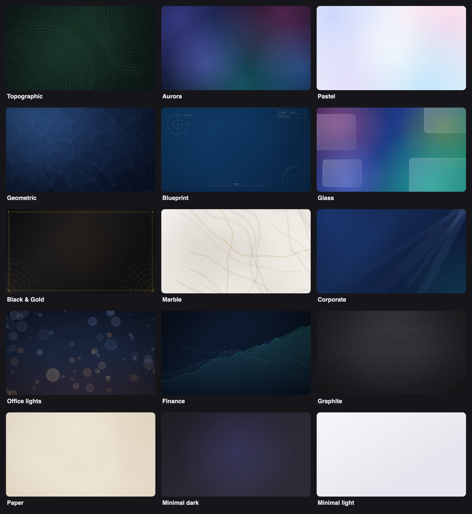
- **İmleç:** Beyaz ok, siyah ok, renkli ok ya da nokta. Renk, boyut, vurgu halkası, hareketsizken gizleme, hareket yumuşatma ve tıklama efekti (halka ya da dolgu) ayarlanabilir.
- Projeler `.focus` klasörlerinde saklanır: ham medya, imleç verisi ve düzenlemeler. Uygulamayı kapatıp açınca kaldığın yerden devam edersin.
- **Focus veya Odak'tan geçiş:** Focara, önceki uygulama profilindeki son projeleri, dili ve mikrofon/kamera seçimlerini getirir. Var olan `.focus` ve `.odak` projeleri yerlerinde kalır ve açılmaya devam eder; yeni kayıtlar **Filmler/Focara** (macOS) ya da **Videolar/Focara** (Windows) içine kaydedilir.
- **Dil:** Arayüz Türkçe ve İngilizce. Focara bilgisayarının diliyle açılır; **⚙ Ayarlar**'dan istediğin an değiştirebilirsin (aşağıda [Dil](#dil)).

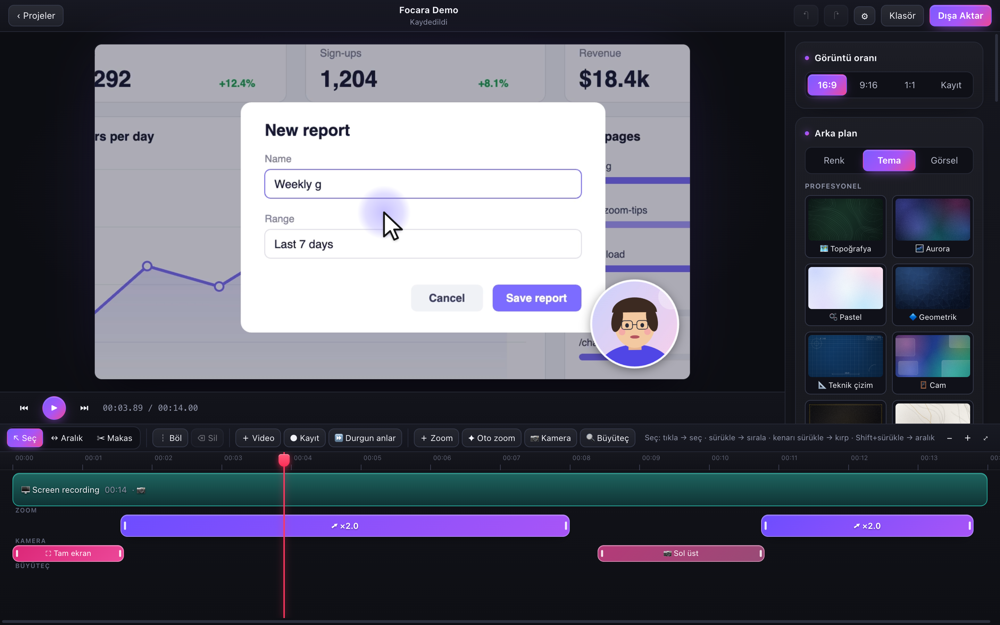

## İndir

[Releases](../../releases) sayfasından ya da Actions çıktılarından:

| Sistem | Dosya | Not |
|---|---|---|
| macOS 14+ (Apple Silicon: M1–M4) | `Focara-x.y.z-mac-arm64.dmg` | Uygulama imzalı/notarize değil. İlk açılışta Sistem Ayarları › Gizlilik ve Güvenlik › **Yine de Aç**. |
| macOS 14+ (Intel) | `Focara-x.y.z-mac-x64.dmg` | Aynı. Rosetta altında selftest'i geçiyor; gerçek bir Intel Mac'te henüz denenmedi. |
| Windows 10 (2004+) / 11 | `Focara-Setup-x.y.z.exe` | İmzalı değil. SmartScreen uyarısında **Ek bilgi › Yine de çalıştır**. Kurulumsuz kullanım için `Focara-x.y.z-win-x64.zip`. |

### macOS'ta Homebrew ile kurulum

İlk sürüm etiketi yayımlandıktan sonra:

```bash
brew tap lioneltchami/tap
brew install --cask focara
```

Homebrew cask'i, dağıtım anahtarı tanımlıysa her sürümden sonra otomatik güncellenir. Focara henüz imzalı/notarize değil; ilk açılışta **Sistem Ayarları › Gizlilik ve Güvenlik › Yine de Aç** gerekebilir.

macOS'ta ilk kayıtta **Ekran ve Sistem Sesi Kaydı** izni istenir. Mikrofon kullanılacaksa mikrofon izni de istenir. İzinden sonra uygulamayı yeniden başlatmak gerekebilir.

## Dil

Focara **Türkçe** ve **İngilizce** konuşur.

- **Otomatik:** Bilgisayarının ilk dili Türkçe ise Focara Türkçe açılır, başka bir dil ise İngilizce.
- **İstediğin an değiştir:** **⚙ Ayarlar**'a tıkla (ana ekranın sağ üstünde ya da editörün araç çubuğundaki ⚙ düğmesi; macOS'ta *Focara › Ayarlar…*, Windows'ta *Dosya › Ayarlar…*, ya da `⌘,` / `Ctrl+,`) ve **Sistem dili**, **Türkçe** ya da **English** seç. Bütün arayüz hemen değişir; açık proje açık kalır, hiçbir şey kaybolmaz.
- Menü çubuğunda iki dilde yazılmış bir **Dil · Language** menüsü de var; hangi dil açık olursa olsun kolayca bulunur.
- Seçimin hatırlanır. Projeler dile bağlı değildir: Türkçe arayüzde yapılan proje İngilizcede de aynen açılır.

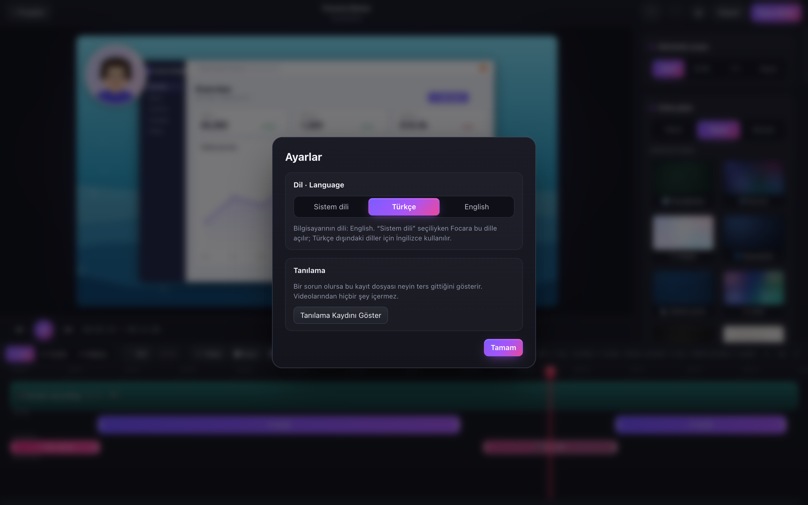

## Kaynaktan çalıştırma

Sürüm etiketini `package.json` sürümüyle aynı tut. CI macOS ve Windows kurulum dosyalarını oluşturur, GitHub Releases'a ekler ve dağıtım anahtarı tanımlıysa Homebrew cask'ini günceller.

Homebrew güncellemelerini açmak için `lioneltchami/homebrew-tap` deposuna yazma izni olan bir deploy key ekle; özel anahtarını bu depodaki `HOMEBREW_TAP_DEPLOY_KEY` Actions secret'ı olarak kaydet. Anahtar yoksa uygulama sürümü yayımlanır, tap güncellemesi atlanır.

Gerekenler:
- Her iki sistem: **Node.js 22**.
- **macOS:** Xcode ya da Command Line Tools (`xcode-select --install`).
- **Windows:** [Rust](https://rustup.rs) ve Visual Studio Build Tools ("C++ ile masaüstü geliştirme").

```bash
npm install
npm run build:helper:mac      # macOS: Swift kayıt yardımcısı
npm run build:helper:win      # Windows: Rust kayıt yardımcısı
npm run dev                   # geliştirme modu
npm run dist:mac              # macOS: .dmg / .zip  → release/
npm run dist:win              # Windows: kurulum .exe / .zip → release/
```

Geliştirme modunda (`npm run dev`) macOS izinleri "Electron" uygulamasına verilir; paketlenmiş uygulamada "Focara"ya.

## Kullanım

1. Ekranı seç. İstersen sistem sesini, mikrofonu ve kamerayı aç; kamera seçilince önizlemesi görünür. Sonra **Kaydı Başlat**'a bas.
2. Durdurmak için üstteki paneli ya da **⌘⇧2 / Ctrl+Shift+2**'yi kullan. Kayıt otomatik zoom'larla düzenleyicide açılır.
3. Zaman çizelgesinde bir zoom'u **sürükle** (taşı) ya da **kenarından** uzat. Tıklayınca sağ panelden miktarını ve odağını değiştirebilirsin.
4. **＋ Zoom** oynatma çizgisine yeni bir zoom ekler. **✦ Oto zoom** dokunulmamış zoom'ları yeniden üretir; elle düzenlediklerin korunur.
5. Sağ paneldeki **Arka plan**, **İmleç**, **Kamera** ve **Ses** bölümlerinden görünümü ayarla. Hiçbir şey seçili değilken bu bölümler görünür.
6. **Dışa Aktar**: biçimi seç, ayarlarını yap, kaydet.

| Biçim | Ne için | Seçenekler |
|---|---|---|
| **MP4** | YouTube ve her yer | H.264 (en uyumlu), HEVC (daha küçük), AV1 (en küçük, yavaş) |
| **MOV** | Final Cut, iMovie, Premiere | H.264, HEVC |
| **WebM** | Web siteleri | VP9, AV1 · ses Opus |
| **GIF** | README, sohbet (sessiz) | 480–1280 px, 10–25 fps; durgun ekran neredeyse yer kaplamaz |
| **Ses · M4A / WAV** | Podcast, altyazı, ses düzenleme | AAC ya da kayıpsız PCM |
| **Kare · PNG** | YouTube kapak görseli | Oynatma çizgisindeki kare, seçilen çözünürlükte |

Video biçimlerinde çözünürlük 720p / 1080p / 1440p / 4K, kare hızı 24 / 30 / 60 ve kalite (Yüksek / Orta / Küçük dosya) seçilir. Bu bilgisayarın kodlayamadığı kodekler listede soluk görünür. **Görüntü oranı** (sağ panelin en üstü ya da dışa aktarma penceresi): 16:9, 9:16 dikey, 1:1 kare ya da kaydın kendi oranı; önizleme hemen değişir. Zaman çizelgesinde bir aralık seçiliyse **Yalnızca seçili aralık** ile sadece o kısım aktarılır.

### Kesme, birleştirme, düzenleme

Zaman çizelgesinin üstündeki çubukta üç araç var. Hangisinin seçili olduğu ve ne yaptığı çubuğun sağında yazar.

| Araç | Ne yapar |
|---|---|
| **↖ Seç** (V) | Klibe tıkla: seçer. Sürükle: sırasını değiştirir. Kenarını sürükle: kırpar. Shift+sürükle: aralık seçer. |
| **↔ Aralık** (R) | Kliplerin üstünde sürükleyerek bir kısmı seçersin. Uçlarından tutup daraltıp genişletebilirsin. Altında **Sil / Ayır / ×2 / ×4** çıkar. |
| **✂ Makas** (C) | Klibe tıkladığın yerden böler. Kesilecek yer kesik çizgiyle gösterilir; oynatma çizgisine yaklaşınca ona yapışır. |

**Oynatma çizgisi** (kırmızı): başındaki kırmızı tutamağı ya da cetveli (en üstteki zaman şeridi) tutup sürükle; önizleme kare kare takip eder. Seç aracındayken çizginin kendisi de tutulabilir.

| İşlem | Nasıl |
|---|---|
| Böl | Oynatma çizgisini getir, **┆ Böl** ya da **S**. Zoom'lar da iki parçaya bölünür. Aralık seçiliyse iki ucundan böler. |
| Kırp | Klibin sol/sağ kenarını sürükle. Sağ kenar oynatma çizgisine yapışır. Kırpılan kısım silinmez, kenarı geri çekince geri gelir. |
| Sırala | Klibi tutup sürükle; bırakacağın yer çizgiyle gösterilir. |
| Sil | Klibi seç, **Sil**. Arkadaki klipler boşluğu kapatır. |
| Bir kısmı sil / hızlandır | **↔ Aralık** ile seç, sonra **Sil**, **×2** ya da **×4**. Birden çok klibi kesse bile tek adımda uygulanır. **Ayır** o kısmı ayrı bir klip yapar; sonra taşıyabilir, hızını ya da sesini ayrıca ayarlayabilirsin. |
| Kamera bölümü | **↔ Aralık** ile seç (örneğin 3:00–5:00), sonra **📷 Kamera**. Aralık seçmeden basarsan oynatma çizgisinden itibaren 3 sn'lik bir bölüm oluşur. Bölüm KAMERA şeridinde görünür. Sağ panelden **Balon** (9 konum + boyut), **Tam ekran** ya da **Gizle** seçilir. Kamera bölümün başında 0.5 sn'de yeni yerine kayar, sonunda geri döner; arka arkaya iki bölüm varsa doğrudan birinden ötekine geçer. Bloğu sürükleyerek taşır, kenarından uzatırsın. Klibi kesip taşısan da bölüm içerikle birlikte gider. |
| Çoğalt / hız | Klibi seç; sağ panelden **Çoğalt**, hız ×0.5–×8, kaynak başı/sonu ve klibin ses düzeyleri. |
| Video ekle | **＋ Video**: bilgisayardaki bir MP4/MOV/M4V/WebM/MKV videosu seçili klibin arkasına (seçim yoksa sona) eklenir ve projeye kopyalanır. |
| Kayıt ekle | **● Kayıt**: açık projeye yeni bir ekran kaydı (kamera/mikrofonla birlikte) eklenir, kendi otomatik zoom'larıyla gelir. |
| Durgun anlar | **⏩ Durgun anlar**: ekranın değişmediği, imlecin durduğu ve ses olmayan anları bulur. Yeni süreyi önceden gösterir; ×2/×4/×8 hızlandırır ya da keser. Her anın başında ve sonunda pay bırakılır. |
| Zaman çizelgesi | **−/＋/⤢** ya da **⌘/Ctrl + tekerlek** ile yakınlaştır. Kliplerin altında ses dalgası görünür. |

Her işlem **geri alınabilir** (⌘/Ctrl+Z). Ham kayıtlar hiç değişmez; düzenlemeler yalnızca `project.json`'a yazılır.

Kısayollar: boşluk (oynat/duraklat), ←/→ (kare kare, Shift ile 10 kare), V / R / C (Seç / Aralık / Makas), S (böl), Z (oynatma çizgisine zoom), K (kamera bölümü), B (büyüteç; K ve B seçili aralığa da uygulanır), Sil (seçili klip, zoom ya da aralık), Esc (seçimi bırak, Seç aracına dön), ⌘/Ctrl+Z ve ⇧⌘/Ctrl+Shift+Z (geri al/yinele), ⌘/Ctrl+E (dışa aktar), ⌘/Ctrl+, (ayarlar ve dil).

## Mimari

```
┌──────────────── Electron (macOS ve Windows'ta aynı kod) ──────────────────┐
│  UI: React + TypeScript                                                   │
│  core/   proje modeli · otomatik zoom · imleç grupları · yaylı kamera     │
│  render/ tek çizici (Canvas 2D) ──┬── önizleme oynatıcısı (Web Audio saati)│
│                                   └── MP4 dışa aktarma (mediabunny/WebCodecs)│
│  media/sideRecorder  kamera + mikrofon (WebCodecs, cihaz seçimli)         │
│  electron/main  dosyalar · proje paketi · menüler · kayıt yönetimi        │
└───────────────┬───────────────────────────────────────────────────────────┘
                │ stdin/stdout JSON satırları (aynı protokol)
     ┌──────────┴──────────┐                ┌─────────────────────────────┐
     │ macOS: Swift         │                │ Windows: Rust                │
     │ ScreenCaptureKit     │                │ Windows Graphics Capture     │
     │ imleç gizli, H.264   │                │ imleç gizli, H.264 (MF)      │
     │ host saati           │                │ QPC saati                    │
     │ sistem sesi          │                │ WASAPI loopback (sistem sesi)│
     └──────────────────────┘                └─────────────────────────────┘
```

- **Neden yerel kayıt yardımcıları?** Electron/Chromium'un ekran yakalayıcısında sistem imlecini gizlemenin güvenilir bir yolu yok. İmleç gizlenmezse imleci yeniden çizmek, yumuşatmak ve boyutlandırmak mümkün olmaz.
- **Senkron:**
  - Ekran kareleri, imleç örnekleri ve sistem sesi aynı saatle (macOS'ta host time, Windows'ta QPC) zaman damgalanır.
  - Yardımcı, ilk ekran karesinin zamanını (t0) bildirir. Kamera ve mikrofon tek bir MediaStream'den geldiği için dudak senkronu korunur ve ikisi bu t0'a hizalanır.
  - Sesler ilk ekran karesine hizalanmış 16 bit WAV olarak yazılır. Boşluklara sessizlik eklenir, çakışan kısımlar atılır.
- **Önizleme = dışa aktarma:** İkisi de aynı `drawFrame` fonksiyonunu ve aynı kare seçme kuralını kullanır. Kural şu: kaynakta o andan önce ya da o anda başlayan son kare. Dışa aktarmada AAC kodlayıcının eklediği "priming" gecikmesi ölçülüp telafi edilir.

Proje paketi (`~/Movies/Focara` ya da `~/Videos/Focara`):

```
Kayıt 2026-10-15 10.12.30.focus/
  project.json                 düzenlemeler (klipler, zoom'lar, görünüm, dışa aktarma ayarları)
  media/<id>/screen.mp4        ham ekran videosu (imleçsiz)
  media/<id>/cursor.json       imleç örnekleri ve tıklamalar
  media/<id>/system.wav        sistem sesi (ayrı iz)
  media/<id>/mic.wav           mikrofon (ayrı iz)
  media/<id>/camera.mp4        kamera (ekranla aynı zaman çizelgesinde)
  assets/                      seçtiğin arka plan görselleri (projeye kopyalanır)
```

## Testler

```bash
npm test               # çekirdek: zoom/kamera algoritması referans sonuçlarla aynı mı; böl/kırp/sırala/hız/aralık sil/durgun anlar;
                       #   çeviriler: her metnin aynı yer tutucularla İngilizcesi var mı, çeviri dışında Türkçe metin kalmış mı
npm run selftest       # uygulama içinde: sentetik kayıt → zoom → kaydet/aç → MP4 → önizleme=dışa aktarma, ses senkronu,
                       #   kamera balonu, görsel/tema arka planlar, imleç stilleri, sahte kamera+mikrofonla kayıt,
                       #   düzenlenmiş çok klipli dışa aktarma (kesik + ×2 + içe aktarılan video + kopya) ve ses senkronu,
                       #   kamera bölümleri (tam ekran, taşınan balon, geçiş kareleri dahil önizleme = dışa aktarma)
npm run uitest -- "examples/Örnek Proje.odak"   # gerçek arayüz: zoom'lar, böl/kırp/sürükle/sil, oynatma çizgisini sürükleme,
                                               #   makas, aralık ×2/ayır/sil, kamera bölümleri, video ekle, durgun anlar, geri al,
                                               #   oynat, otomatik kayıt, Ayarlar'dan dil değiştirme ve İngilizce
                                               #   arayüzde Türkçe metin kalmaması (`--lang en` ile her akış İngilizce;
                                               #   CI ikisini de çalıştırır)
npm run docshots       # docs/images: banner, ekran görüntüleri, kareler, tema galerileri, GIF'ler (İngilizce arayüz)
npm run docshots:tr    # banner ve editör ekran görüntüleri Türkçe arayüzle → docs/images/tr (bu README)
npm run perftest       # performans: 40 sn 2560×1600@60 kayıt + kamera + 2 ses izi, 16 klip, zoom'lar ve kamera bölümleri;
                       #   gerçek editörde oynatma (kesimler dahil), sürükleme, düzenleme, zaman çizelgesi, dışa aktarma
zsh native/mac/test.sh                         # macOS yardımcısı: WAV hizalaması, anahtar karelerin en fazla ~1 sn arayla olması
node scripts/helper-smoke.mjs                  # kayıt yardımcısıyla 3 sn gerçek kayıt (izin gerekir)
cargo test --manifest-path native/win/Cargo.toml   # Windows yardımcısının WAV hizalaması
```

Selftest ayrıca her dışa aktarma biçimini gerçekten üretip açar: boyut, süre ve sesin yeri (milisaniye düzeyinde) denetlenir; GIF'in kareleri ve süresi bayt düzeyinde, PNG ise videodaki kareyle karşılaştırılır.

`.github/workflows/build.yml`, bunların hepsini **Windows ve macOS** makinelerinde çalıştırır ve kurulum dosyalarını üretir. CI makinelerinde ekran kartı olmadığı için performans testi orada yalnızca rapor verir.

### Performans

`npm run perftest` sonuçları (Apple M4 Pro, 120 Hz ekran, paketlenmiş uygulama):

| Ölçüm | Sonuç |
|---|---|
| Projeyi açma → ilk kare | ~0.12 sn |
| Oynatma | ekranın tazeleme hızında (120 kare/sn), geç kalan kare yok, kesimlerde bile kareler arası en uzun boşluk ~10 ms |
| Oynatma çizgisini sürükleme | ~59 kare/sn, bırakınca tam kare ~40 ms'de |
| Düzenleme (böl, seç, geri al…) | tıklamadan ekrana ~17 ms |
| Zaman çizelgesi yakınlaştırma/kaydırma | takılma yok |
| 1080p60 dışa aktarma | gerçek zamanın ~3 katı hızında, bu sırada arayüz akıcı |

Bunu sağlayan beş şey:
- Oynatma bir kesime yaklaşınca sonraki klibin çözücüsü önceden açılır; kesim anında beklenmez.
- Editör boştayken projede görünecek her kare türü bir kez ekran dışında çizilir. Böylece ekran kartı, oynatma sırasında yeni bir çizim türünü hazırlamak için durmaz.
- İmleç ve tema önizlemeleri işlemcide çizilir; oynatırken yalnızca süre ve oynat düğmesi yeniden çizilir. Böylece ekran kartı henüz hiçbir şeyi önbelleğe almamışken, yani ilk açılışta bile oynatma takılmadan başlar.
- Sürüklerken her konum için en yakın anahtar kare gösterilir (bir kare çözmek yeter), durunca tam kare gelir.
- macOS kayıtlarında en az saniyede bir anahtar kare vardır. Ekran durgunken kareler seyrek geldiği için bu ayrıca zamana göre sınırlanır.

## Bilinen sınırlar

- Uygulamalar Apple/Microsoft sertifikasıyla imzalı değil. İlk açılışta yukarıdaki uyarılar çıkar.
- 4096×2304'ten büyük ekranlar: macOS'ta kayıt bu boyuta sığdırılır. Windows'ta HEVC kullanılır ve bu kayıtlar ancak HEVC çözebilen bilgisayarlarda düzenlenebilir.
- Linux'ta düzenleme ve dışa aktarma çalışır, kayıt henüz desteklenmiyor.
- Hızı 1× olmayan kliplerde ses kapatılır (sesi perdesini bozmadan hızlandırma henüz yok).
- Durgun anlar yalnızca Focara'nın kendi ekran kayıtlarında aranır; içe aktarılan videolarda imleç verisi olmadığı için analiz edilmez.
- Windows'ta kullanılan yakalama kütüphanesi anahtar kare aralığını ayarlamaya izin vermiyor. Oynatıcı sonraki klibi gerektiğinde daha erken açarak bunu telafi eder. Windows'taki performans henüz ölçülmedi; CI iş akışı performans testini orada rapor olarak çalıştırır.
